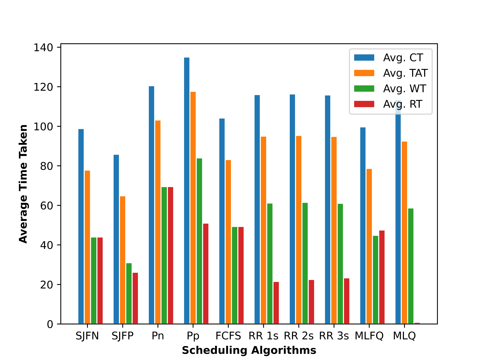

# Process Scheduling Algorithms Simulation

A single-CPU process scheduling simulator in C++. It runs eight classic scheduling algorithms on the same workload and uses Python and Matplotlib to plot how they compare.


## Overview

CPU scheduling decides which ready process gets the CPU next. This project reads a list of processes (arrival time, burst time, priority) from a CSV file and simulates each algorithm on a single CPU. For every process it computes:

- **Completion time (CT)**
- **Turnaround time (TAT)** = CT − arrival time
- **Waiting time (WT)** = TAT − burst time
- **Response time (RT)**

The C++ simulators write per-process results to a temporary CSV file. Python scripts then plot charts for each algorithm, plus a set of comparison charts built from the averages across all algorithms.

## Algorithms

| Algorithm | Notes |
| --- | --- |
| First Come First Serve (FCFS) | Non-preemptive, in order of arrival |
| Shortest Job First, non-preemptive (SJFN) | Shortest burst among arrived processes |
| Shortest Job First, preemptive (SJFP) | Shortest remaining time first |
| Priority, non-preemptive | Higher priority value is scheduled first |
| Priority, preemptive | A higher-priority arrival preempts the running process |
| Round Robin (RR) | Run with time quanta of 1, 2 and 3 |
| Multilevel Queue (MLQ) | 3 Round Robin queues (quantum 2). A process is placed in queue `priority % 3`, and higher queues are served first |
| Multilevel Feedback Queue (MLFQ) | 3 levels: two Round Robin levels (quantum 2) and a final FCFS level. New arrivals enter the top level and are demoted once their accumulated run time reaches the feedback threshold (2) |

## Features

- One input file drives every algorithm, so the results are directly comparable.
- Two charts per algorithm: a per-process line/scatter plot of CT, TAT, WT and RT, and a stacked bar chart.
- Comparison bar charts of average CT, TAT, WT and RT across all algorithms, plus a grouped multi-bar chart.
- A summary table of the averages printed to the terminal.

## Tech stack

- **Simulation:** C++
- **Visualisation:** Python 3, Matplotlib, NumPy

## Project structure

```
Process-Scheduling-Algorithms-Simulation/
├── mainCPP.cpp              # Entry point: runs every algorithm and collects averages
├── roundAndFcfs.cpp         # FCFS and Round Robin
├── SJFN.cpp / SJFP.cpp      # Shortest Job First (non-preemptive / preemptive)
├── priority.cpp             # Priority scheduling (non-preemptive / preemptive)
├── multilevel.cpp           # Multilevel Queue
├── multilevel-feedback.cpp  # Multilevel Feedback Queue
├── graphPloat.py            # Per-algorithm line/scatter chart
├── graphStackPlot.py        # Per-algorithm stacked bar chart
├── graphBarPloat.py         # Cross-algorithm comparison charts + summary table
├── process.csv              # Sample input
└── graph/                   # Generated charts (sample output committed)
```

## Getting started

### Prerequisites

- Linux
- `g++`, Python 3 with development headers, Matplotlib and NumPy

```bash
sudo apt install g++ python3-dev python3-pip
pip3 install matplotlib numpy
```

### Build

`mainCPP.cpp` `#include`s the other `.cpp` files, so compile only that file. The sources include `<Python.h>`, so pass the Python include path:

```bash
git clone https://github.com/mkk96/Process-Scheduling-Algorithms-Simulation.git
cd Process-Scheduling-Algorithms-Simulation
g++ $(python3-config --includes) mainCPP.cpp -o main
```

You can also give the path directly, for example `g++ -I /usr/include/python3.8 mainCPP.cpp -o main`.

### Run

Run from the repository root. The plotting scripts and the `graph/` folder are referenced by relative paths.

```bash
./main process.csv
```

Charts are written to `graph/`, and the table of averages is printed to the terminal.

## Input format

The input is a CSV file with no header row. Each line describes one process:

```text
PID,name,type,priority,arrival_time,burst_time
```

Example (from `process.csv`):

```text
0,Cattxodmfnf,C,67,22,1
1,Ilwxybakmse,C,71,9,45
2,Cytpnzestug,C,26,12,2
3,Igchqocvfbh,C,96,28,80
4,Isjhkfcrgxt,C,93,25,26
```

- PIDs should run from `0` to `n-1`, because they are used as array indices.
- The multilevel schedulers only pick up rows whose `type` is `C`.

## Output

| File(s) in `graph/` | Contents |
| --- | --- |
| `FCFS.jpeg`, `SJFN.jpeg`, `SJFP.jpeg`, `priority_NP.jpeg`, `priority_P.jpeg`, `RR_1s.jpeg`, `RR_2s.jpeg`, `RR_3s.jpeg`, `multilevel.jpeg`, `multilevel-feedback.jpeg` | Per-process CT / TAT / WT / RT for each algorithm |
| `*_Stack.jpeg` | Stacked bar version of the same data |
| `averageCT.jpeg`, `averageTAT.jpeg`, `averageWT.jpeg`, `averageRT.jpeg` | Average of each metric across algorithms |
| `multiBar.jpeg` | All four averages side by side for every algorithm |

Sample comparison chart (from the committed `graph/` output):



## Context

Built during the M.Tech programme at IIIT Hyderabad (2021).

---

Made by [Mukul Kumar](https://mkk96.github.io) · [GitHub](https://github.com/mkk96) · [LinkedIn](https://www.linkedin.com/in/mukul-kumar-60322616b/)
